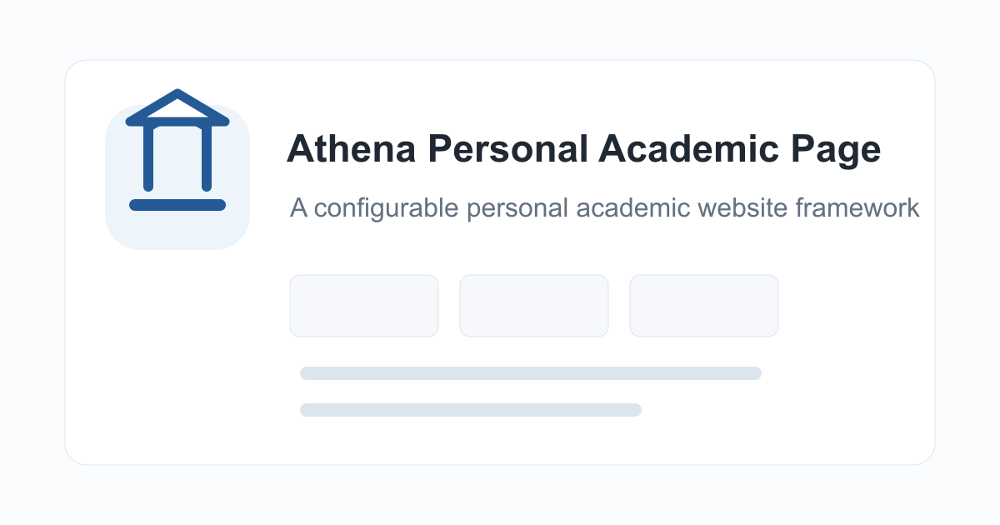

<div align="center">
  
  <h1>Athena Personal Academic Page</h1>
  <p>A clean, publication-first academic homepage for researchers.</p>
  <p>
    <a href="https://aaronz345.github.io/Athena-personal-academic-page/"><strong>View the live demo ↗</strong></a>
    &nbsp;·&nbsp;
    <a href="https://github.com/new?template_name=Athena-personal-academic-page&template_owner=AaronZ345"><strong>Use this template ↗</strong></a>
    &nbsp;·&nbsp;
    <a href="src/content/README.md">Content guide</a>
    &nbsp;·&nbsp;
    <a href="#deploy-with-github-pages">Deployment</a>
  </p>
  <p>
    <a href="https://github.com/AaronZ345/Athena-personal-academic-page/actions/workflows/pages.yml"></a>
    <a href="https://react.dev/"></a>
    <a href="https://vite.dev/"></a>
    <a href="LICENSE"></a>
  </p>
</div>

<a href="https://aaronz345.github.io/Athena-personal-academic-page/">
  
</a>

Athena is a React and Vite template for maintaining an academic website without mixing content into page components. Profiles, publications, projects, teaching, talks, awards, service, and site metadata all live in small files under `src/content/`.

## Make it yours

1. Click [Use this template](https://github.com/new?template_name=Athena-personal-academic-page&template_owner=AaronZ345). Name your repository `USERNAME.github.io` for an account homepage, or choose another name for a project site.
2. Edit the files in `src/content/`. You can use GitHub's web editor or a local editor. Set your profile, publications, and the site title in `site.js`.
3. In **Settings → Pages**, set **Source** to **GitHub Actions**. Push or merge your edits into `main`; the included workflow builds and publishes the site automatically.

After setup, ordinary updates are just content edits and a commit. Local preview is optional.

## What to edit

| File under `src/content/` | Content |
| --- | --- |
| `profile.js` | Name, bio, affiliation, avatar, and contact links |
| `publications.js` | Papers, authors, venues, groups, and links |
| `projects.js` | Project cards and links |
| `news.js` | News timeline |
| `site.js` | Site title, section order, visibility, and optional custom domain |
| `teaching.js`, `talks.js` | Teaching and talks |
| `education.js`, `experience.js` | Education and positions |
| `awards.js`, `services.js` | Honors and academic service |

To hide an optional section, set `enabled: false` on its entry in `site.js`. Reorder the `sections` array to change the page and navigation order. The page components in `src/App.jsx` read these content files; ordinary content edits need no component changes.

## Add content

Add an object inside the existing array in the named file. Keep your other entries after it, separated by commas. The examples show the surrounding export for context; each file needs only one export with that name.

### Add a publication

In [`src/content/publications.js`](src/content/publications.js):

```js
export const publications = [
  {
    title: "Evaluating Research Assistants",
    venue: "Preprint",
    year: "2026",
    type: "Report",
    group: "Machine Learning",
    authors: "Researcher Name, Collaborator A",
    links: [
      { label: "Paper", href: "https://example.com/research-assistants.pdf" },
      { label: "Code", href: "https://github.com/USERNAME/research-assistants" }
    ]
  },
  // Keep your other publications here.
];
```

This creates a compact row. Use an existing `group`, or add your own to `publicationGroups` in `site.js` to choose its position. Add `featured: true` for a large card. Featured papers appear first within a group; each set keeps array order.

### Add a project

In [`src/content/projects.js`](src/content/projects.js):

```js
export const projects = [
  {
    title: "Research Assistant Toolkit",
    status: "Active",
    summary: "Scripts and evaluation data for comparing research assistants.",
    tags: ["Evaluation", "Open Source"],
    links: [
      { label: "Code", href: "https://github.com/USERNAME/research-assistants" },
      { label: "Demo", href: "https://example.com/research-assistants" }
    ]
  },
  // Keep your other projects here.
];
```

Projects appear in array order. Put an entry first to make it the first card.

### Add a news item

In [`src/content/news.js`](src/content/news.js):

```js
export const news = [
  {
    date: "2026.10",
    icon: "release",
    text: "The Research Assistant Toolkit is now available.",
    href: "https://example.com/research-assistants"
  },
  // Keep your older news here.
];
```

Keep news newest first: the page uses array order, and Profile Details shows the first four items. Other icon names include `accepted`, `dataset`, `talk`, `award`, and `career`.

## Deploy with GitHub Pages

Replace `USERNAME` with your account name. `academic-site` below is an example repository name.

| Repository | Published URL | Asset base path |
| --- | --- | --- |
| `USERNAME.github.io` | `https://USERNAME.github.io/` | `/` |
| `academic-site` | `https://USERNAME.github.io/academic-site/` | `/academic-site/` |

Leave `siteMeta.url` empty, as it is in the template. The workflow sets `GITHUB_REPOSITORY`, and Vite derives the public site URL, asset base path, and sharing-image URL. Both setups use the same workflow with no URL changes. The base path tells the browser where to load scripts, styles, and icons; a wrong prefix can cause 404s.

The PNG preview image is included. To replace it, change `siteMeta.image` to a path such as `"images/my-preview.png"`; Vite turns it into the correct absolute public URL.

After enabling **GitHub Actions** in **Settings → Pages**, push or merge into `main`. Wait for **Actions → Deploy Pages** to succeed, then open the published URL in **Settings → Pages**.

For a custom domain, set `siteMeta.url` once in `src/content/site.js`, for example `url: "https://researcher.example.org/"`. Its path controls the build base, and relative sharing-image paths follow it automatically. See the [deployment reference](src/content/README.md#deployment-reference) for domain setup, other branches, and manual deployment.

## Optional local preview

Install [Node.js 22 LTS](https://nodejs.org/) to match the deployment workflow. Replace `USERNAME` and `REPOSITORY` with your repository details:

```bash
git clone https://github.com/USERNAME/REPOSITORY.git
cd REPOSITORY
npm ci
npm run dev
```

Open `http://127.0.0.1:5173/`; saving a content file updates the local page. See the [deployment reference](src/content/README.md#preview-a-production-build) to preview the production build under a repository subpath.

## More options

The [content reference](src/content/README.md) covers every field, publication cards and grouping, rich text, image formats, section settings, and GitHub star badges.

Put custom images in `public/images/` and use paths such as `"images/my-paper.png"` in content files. Each publication figure needs just one file: PNG, JPEG, WebP, and SVG work directly. See the [image guide](src/content/README.md#publication-images) for sizing. Keep social preview images in PNG or JPEG format.

## License

Athena Personal Academic Page is available under the [MIT License](LICENSE).
